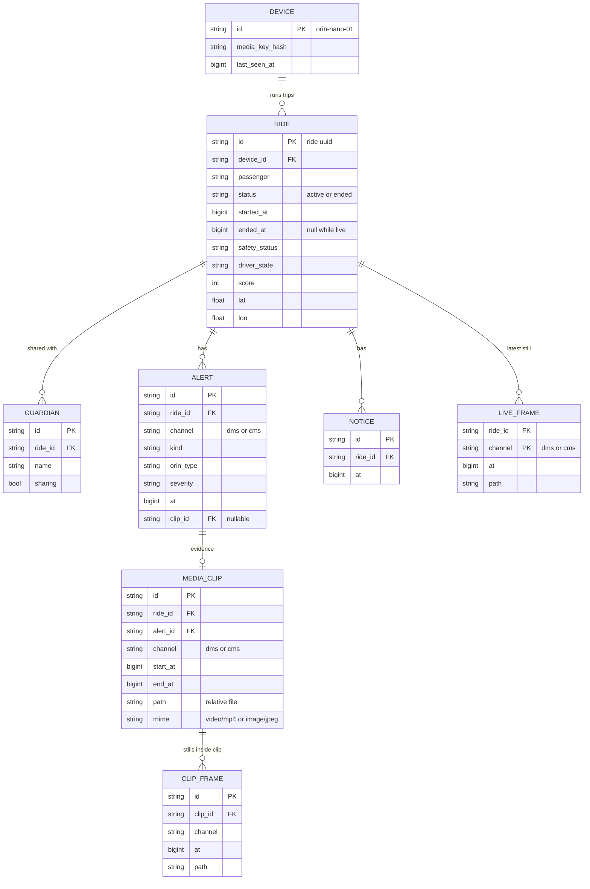
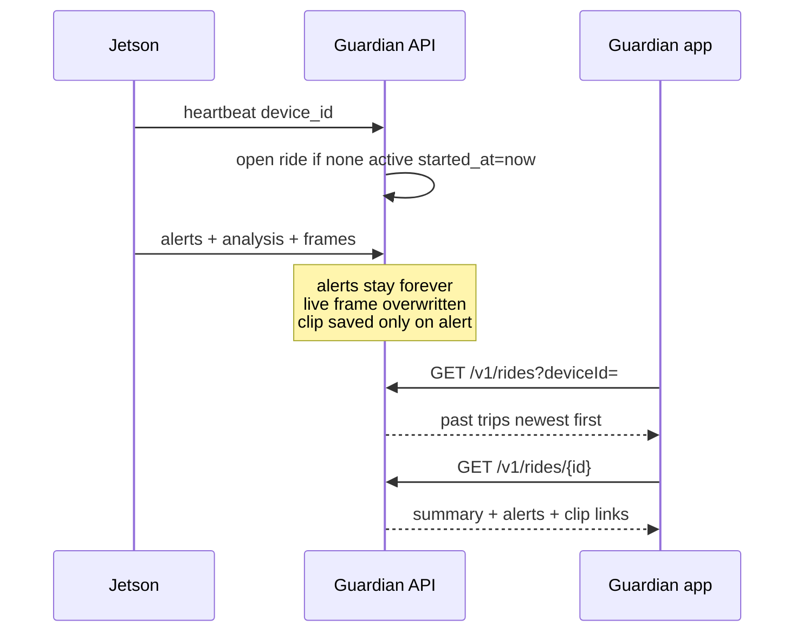

# Ride history, alert clips, and timestamped frames

Plan only. Guardian already gets the **current** ride (`GET /v1/rides/{id}`), alerts, and dummy video stills. Those rows are overwritten in place, so there is no trip history and no clip tied to an alert.

Times are Unix epoch **milliseconds** (`at`), same as alerts today.

---

## What gets stored

| Data | Keep? | Where |
|---|---|---|
| One row per trip (start, end, device, passenger, score) | yes | `rides` |
| Every alert with `channel` dms/cms | yes | `alerts` (already) |
| Short clip when an alert fires | yes | file on disk + `media_clips` row |
| Latest DMS frame and latest CMS frame | yes | small files + `live_frames` (one row per ride+channel, replaced) |
| Full trip video | **no** | too large for 4G and Postgres |
| Every VLM sentence | optional later | `analysis_samples` only if the history screen needs it |

Postgres stores **metadata**. JPEG/MP4 bytes live in a folder or object store (`MEDIA_DIR`), not in a database column.

---

## ER diagram



`LIVE_FRAME` primary key is `(ride_id, channel)` so DMS and CMS each have **one** current still. Older stills are not a timeline unless they were copied into a clip.

`CLIP_FRAME` is the timeline inside an alert: a few JPEGs with `at`, plus one MP4 if the Jetson encoded it.

---

## How a trip is recorded



Today every device falls back to `ride-1842`. History needs **one active ride per device**. When the vehicle goes offline for N minutes (or an explicit end), set `ended_at` and `status=ended`. The next online session inserts a **new** `ride` id. Do not reuse `ride-1842` for every trip.

---

## Alert clip

On alert (DMS or CMS):

1. Jetson already has the latest frames. It keeps a short ring (about 8 s) per channel in memory.
2. On alert it uploads one clip for **that channel**:
   - `channel=dms` for driver alerts
   - `channel=cms` for cabin alerts
3. Body is a few JPEGs **or** one short MP4, each sample tagged with `at`.
4. API writes files under `media/{rideId}/{alertId}/` and inserts `media_clips` (+ `clip_frames`).
5. `alerts.evidence_id` / `clip_id` points at that clip.

Suggested clip window: **4 s before** the alert `at` and **4 s after** (or whatever is in the ring). Not the whole ride.

---

## APIs (Guardian)

All `at` values are epoch milliseconds.

### History list

`GET /v1/history?deviceId=orin-nano-01`

```json
{
  "rides": [
    {
      "id": "ride-a1",
      "deviceId": "orin-nano-01",
      "status": "ended",
      "startedAt": 1761560000000,
      "endedAt": 1761563600000,
      "safetyStatus": "caution",
      "score": 82,
      "alertCount": 3
    }
  ]
}
```

`GET /v1/rides/{rideId}` stays the live/detail snapshot and gains `startedAt`, `endedAt`, `status`.

### Alerts on that trip

`GET /v1/rides/{rideId}/alerts?channel=dms|cms`

Existing alert object plus:

```json
{ "clipId": "clip-9f", "at": 1761561200000 }
```

### Clip playback

`GET /v1/rides/{rideId}/clips/{clipId}`

```json
{
  "id": "clip-9f",
  "alertId": "…",
  "channel": "dms",
  "startAt": 1761561196000,
  "endAt": 1761561204000,
  "frames": [
    { "at": 1761561196000, "url": "/v1/media/clip-9f/0.jpg" },
    { "at": 1761561200000, "url": "/v1/media/clip-9f/1.jpg" }
  ],
  "videoUrl": null
}
```

`GET /v1/media/{clipId}/{file}` returns the bytes. Sharing off → **403**. Unknown ride → **404**.

### Live frame (DMS and CMS, with timestamp)

Not the history list. This is the **current** still, separate per channel.

`GET /v1/rides/{rideId}/frames/live?channel=dms`

`GET /v1/rides/{rideId}/frames/live?channel=cms`

```json
{
  "rideId": "ride-a1",
  "channel": "dms",
  "at": 1761561800500,
  "url": "/v1/rides/ride-a1/frames/live/image?channel=dms"
}
```

`GET /v1/rides/{rideId}/frames/live/image?channel=dms` → JPEG.

`at` is when the Jetson captured the frame, not when the phone asked. If `at` is older than ~15 s, the app shows “stale”.

Same sharing rule as video: sharing off → **403**.

Jetson already posts dummy frames. Each post must include `at`. The API replaces `live_frames` for that channel and does **not** append a new row.

---

## What the phone shows

| Screen | Call |
|---|---|
| Past trips | `GET /v1/history?deviceId=` |
| One trip | `GET /v1/rides/{id}` + `GET …/alerts` |
| Alert evidence | `GET …/clips/{clipId}` then image URLs |
| Live driver tile | `GET …/frames/live?channel=dms` poll ~1 s |
| Live cabin tile | `GET …/frames/live?channel=cms` |

WebRTC/LiveKit stays the smooth live video path. These frame APIs are the timestamped stills (and the fallback while LiveKit is dummy).

---

## Build order

1. Add `started_at`, `ended_at`, `status` on rides. New ride id per trip. Stop collapsing every device onto `ride-1842`.
2. `GET /v1/history`.
3. `live_frames` + `at` on the existing frame upload. `GET …/frames/live`.
4. On alert, Jetson uploads the ring → `media_clips` + files. Link `alerts.clip_id`.
5. `GET …/clips/{id}`.

Do not put MP4 bytes in SQLite/Postgres. Do not record the whole ride.
