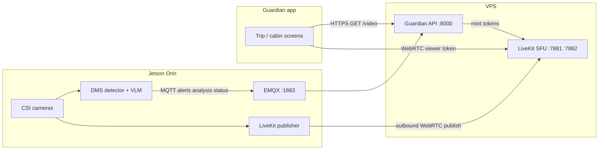
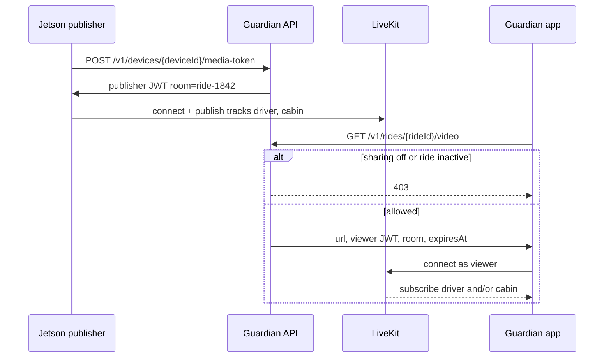
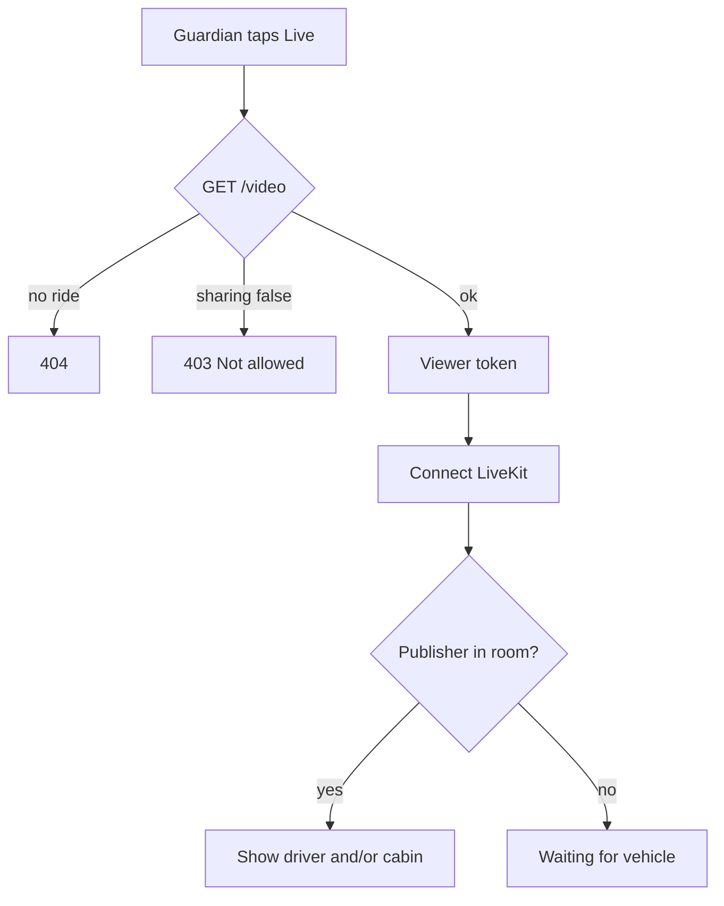

# Guardian live video (WebRTC) — implementation plan

Live cabin video for the Guardian app. Alerts, seats, and VLM analysis stay on MQTT + the existing HTTP API. Video is a **separate media plane** using a LiveKit SFU on the VPS.

This is **not** a phone call to the Jetson. The car never accepts inbound connections. The phone never talks MQTT. Guardian asks **your API** for a short-lived viewer token, then Watch connects to **LiveKit**, which already has the Jetson publishing.

---

## 1. Product answer: watch, not a direct call

| Question | Answer |
|---|---|
| Does Guardian connect to the Jetson? | **No.** Phone → HTTPS API (token) → WebRTC to LiveKit. Jetson → outbound WebRTC to LiveKit. |
| Is it like FaceTime (ring / answer)? | **Not in v1.** It is **live watch** of cameras the vehicle is already publishing. |
| Who allows it? | **Trip sharing**, not a per-tap “answer.” If the ride is active and sharing is on, `GET /video` returns a token. If sharing is off, **403**. |
| Can the cabin refuse? | v1: sharing toggle (passenger/guardian list you already have). v2: optional **request / accept** before tracks go live. |

**v1 (build this):** Jetson publishes driver + cabin tracks whenever DMS is running. Guardian taps Live. API checks ride + sharing, mints a **viewer** token (15 min). App subscribes. No ring on the Orin dashboard.

**v2 (later):** Guardian taps Request live. API stores `video_request`. Jetson (or passenger phone) shows Accept / Deny. Only after accept does the publisher unmute tracks (or start publishing). Deny or timeout → app shows “not allowed.” Use this if legal/consent requires an explicit tap per view.

Do not build P2P (phone ICE to Jetson). Cellular NAT makes that unreliable; LiveKit is the CellularCam pattern that fits 4G.

---

## 2. Topology



Control plane (thin): HTTPS + MQTT.  
Media plane (fat): WebRTC via LiveKit only.



---

## 3. What we reuse vs what we add

Reuse from CellularCam’s **idea**, not its Pi/React repo:

- Outbound-only edge publisher
- Short-lived SFU tokens
- Camera identity vs viewer identity
- LiveKit ports / TURN later

Stay in **this** product:

| Piece | Role |
|---|---|
| `dms/capture.py` | Single owner of CSI frames. Publisher reads `latest()`, does not open the camera again. |
| MQTT + `GET /analysis` | Alerts and VLM text unchanged. |
| Guardian API | Only place the phone talks. New `/video` and device media-token routes. |
| Ride `deviceId` + guardians `sharing` | Access control for viewers. |
| Expo app | LiveKit client; still `EXPO_PUBLIC_MQTT_URL` empty. |

Add:

- LiveKit server on the **same VPS** as EMQX (not on the Jetson, not on Render if UDP is painful — VPS is better).
- Jetson `tools/livekit_publisher.py` (or `dms/webrtc_publisher.py`) as a thread/process.
- API env: `LIVEKIT_URL`, `LIVEKIT_API_KEY`, `LIVEKIT_API_SECRET`.
- Expo: LiveKit room connect on the cabin/driver live tile.

---

## 4. Rooms, tracks, identities

- **Room:** `ride-{rideId}` (example `ride-1842`). One active ride = one room.
- **Publisher identity:** `camera-{deviceId}` (example `camera-orin-nano-01`).
- **Viewer identity:** `viewer-{guardianId}` or `viewer-{rideId}-{random}`.
- **Tracks:** `driver` (DMS camera), `cabin` (CMS camera). App picks which tile to show.
- Encoder target v1: 640×360 @ 8–12 fps, ~400–800 kbps per track. Do not stream detector overlay at 15 FPS full HD over 4G.

CSI: use existing GStreamer grab; encode JPEG/H.264 in the publisher. USB V4L2 from the CellularCam agent is **not** the Orin path.

---

## 5. API contract (phone and Jetson)

Phone (Guardian):

```http
GET /v1/rides/{rideId}/video?track=driver|cabin|all
Authorization: none today; later the guardian session
```

```json
{
  "url": "wss://VPS_IP:7880",
  "token": "<livekit viewer jwt>",
  "room": "ride-1842",
  "tracks": ["driver", "cabin"],
  "expiresAt": 1761560900000
}
```

- 404 ride missing  
- 403 sharing off or no permission  
- 503 LiveKit not configured / Jetson not publishing (optional `publisherOnline` flag)

Jetson (publisher, not the phone):

```http
POST /v1/devices/{deviceId}/media-token
{ "device_id": "orin-nano-01", "key": "<device secret>" }
```

Returns a **publisher** JWT (longer than viewer, still rotated, e.g. 30 min). Jetson reconnects before expiry.

WebSocket `/live` stays telemetry/alerts/analysis. Do **not** put video frames on that socket.

---

## 6. Permission and privacy (v1 vs v2)



**v1 policy**

- Starting the trip + guardian `sharing: true` **is** consent to watch.
- Same bar as seeing SOS and cabin occupancy.
- No ring, no accept button on the Orin HMI.
- Stop publishing when DMS stops (`./run.sh` exit) or a future `videoEnabled: false` in config.

**v2 policy (explicit call-style)**

1. Guardian `POST /v1/rides/{id}/video/request`  
2. Ride/passenger device or Orin UI: Accept / Deny (timeout 30 s)  
3. Accept → publisher enables tracks; API returns `/video`  
4. Deny → 403 `denied`  
5. API can hang up: remove the viewer from the LiveKit room (CellularCam already warns: disable without kick is not enough)

Legal: in-cabin cameras may need visible indicator and passenger notice. That is policy, not WebRTC.

---

## 7. Implementation phases

### Phase 0 — VPS LiveKit (1 session)

- Install official LiveKit binary on the VPS; pin version.  
- Config from LiveKit’s sample: keys = values in guardian API env.  
- Firewall: 7881/tcp, 7882/udp (plus 443 if you put the SFU behind TLS). Keep 7880 off the public internet if the API is the only token source.  
- Prove with LiveKit’s example meet page and a test token. **No Jetson yet.**

### Phase 1 — Jetson publishes one track

- New publisher reads `capture.driver.latest()`.  
- Fetch publisher token from API; connect; publish `driver`.  
- Reconnect loop (same spirit as MQTT outbox, but media is latest-frame, not queued).  
- Flag `--no-webrtc` / `webrtc.enabled: false` so DMS still runs without LiveKit.  
- Confirm a laptop viewer sees the driver camera.

### Phase 2 — Guardian watch

- `GET /v1/rides/{id}/video`  
- Expo: connect, subscribe `driver`, show on cabin/driver screen.  
- Gate on `sharing`.  
- Empty state: “Vehicle camera offline” if no publisher.

### Phase 3 — Cabin track + hygiene

- Second track `cabin` from passenger capture.  
- Bitrate caps, 4G backoff (drop cabin first).  
- Optional TURN if ICE fails on some carriers.  
- Token refresh in the app before `expiresAt`.

### Phase 4 — optional permission call

- Request/accept as in §6 v2.  
- Kick viewer on sharing toggle off.  
- In-cabin LED / on-screen “Guardian viewing.”

Do not start Phase 4 before Phases 0–2 work on one ride (`ride-1842` / `orin-nano-01`).

---

## 8. Security (minimum)

- Phone never gets `LIVEKIT_API_SECRET` or MQTT publisher password.  
- Viewer JWT: room join + subscribe only, **cannot publish**.  
- Publisher JWT: that room only, publish only, identity `camera-*`.  
- Sharing off → no new tokens; v2 also RoomService `RemoveParticipant`.  
- TLS for API; `wss` for LiveKit in production.  
- SFU sees the video (not E2EE unless you add LiveKit E2EE later). Same as CellularCam.

---

## 9. What we explicitly will not do in v1

- Direct WebRTC from app to Orin  
- Putting LiveKit on the Jetson  
- Two-way talk (mic/speaker / AEC)  
- Recording / cloud DVR  
- Replacing MQTT with WebRTC data channels  
- Opening CSI twice  

---

## 10. How to try it once built

1. VPS LiveKit up; `GET http://VPS:8000/health` still shows MQTT connected.  
2. Jetson: same MQTT credentials as today **plus** media token URL; `./run.sh` with webrtc on.  
3. Guardian: same `EXPO_PUBLIC_TELEMETRY_URL`; open the trip; tap Live.  
4. If sharing is on → video. If off → not allowed. No “answer” on the car.

When Phase 2 works, the Guardian “call” is **watch the room**, not **dial the device**.

---

## 11. Dummy path (implemented, no LiveKit binary)

Until the SFU is installed, `LIVEKIT_URL=dummy://local`:

1. Jetson (or tests) `POST /v1/devices/{deviceId}/media-token` then `POST …/video/frame` with a JPEG.
2. Guardian `GET /v1/rides/{rideId}/video` — viewer JWT + `publisherOnline`.
3. Guardian `GET /v1/rides/{rideId}/video/preview?track=driver` — last dummy still.

Enable on the Orin: `./run.sh --webrtc --no-vlm` with `DMS_WEBRTC_API_URL` pointing at the API.

Tests: `pytest tests/test_webrtc_dummy.py`.
